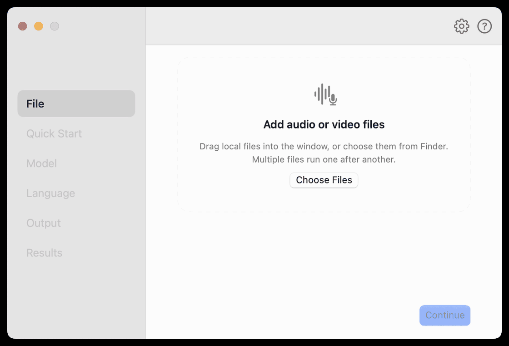

# Whisper for Mac

Whisper for Mac is a native macOS app for offline speech-to-text using OpenAI’s Whisper models.
Audio is processed entirely on your Mac, without a Python installation or a cloud account.

[Download the latest macOS release](https://github.com/AwakeAndReady/whisper-for-mac/releases/latest)



## Features

- ⚡ Fast local transcription with Apple Silicon acceleration
- 🎯 Whisper models from Tiny to Large, including multilingual and English-only models
- 🌍 Automatic language detection and translation into English
- 📂 Multiple-file transcription queues with cancellation and retry
- 📝 TXT transcripts and VTT or SRT subtitles
- 🔒 Verified model downloads with support for resuming interrupted downloads
- 🌗 Automatic Light and Dark Mode that follows your macOS appearance

## Using Whisper for Mac

1. Download and install the app as described below.
2. Install a Whisper model in **Settings**.
3. Add one or more audio or video files by dragging them into the app or using the file picker.
4. Choose the model, language, transcription or translation task, and output formats, then start transcribing. **Quick Start** reuses your saved settings; **Change Settings** opens the setup wizard.
5. Find the results next to the source media or in your chosen output folder. You can export TXT, VTT, and SRT individually or together.

The full transcript can also be copied as plain text, including when exporting only subtitles.

Multiple files are processed in order with the same settings. You can stop the queue and retry failed or unfinished files; completed outputs are retained. Queues are not restored after quitting the app.

Completion notifications and automatic Finder reveal can be configured in **Settings > Output > When Finished**.

## Requirements

- macOS 15 or newer
- Apple Silicon or Intel Mac
- Internet connection only for downloading Whisper models

## Installation

Download the Universal app ZIP from the [latest GitHub Release](https://github.com/AwakeAndReady/whisper-for-mac/releases/latest). Unzipping creates a folder with `WhisperForMac.app` and a [README.txt](distribution/README.txt) containing installation steps. Quit any running copy, then move the app from that folder to Applications.

The app is currently distributed without Apple Developer ID signing or notarization. If macOS says it cannot verify the app for malware, click **Done**, then open **System Settings → Privacy & Security → Open Anyway** and confirm **Open**. Only do this if you trust the download from this repository. You may need to repeat the approval for each new download.

<details>
<summary>Verify a download (optional)</summary>

New releases built with the release workflow include a signed build attestation. With the [GitHub CLI](https://cli.github.com/) installed, run this from the folder containing the downloaded ZIP, replacing `X.Y.Z` with its version:

```bash
version="X.Y.Z"
gh attestation verify "WhisperForMac-v${version}-macOS-universal.zip" \
  --repo AwakeAndReady/whisper-for-mac \
  --signer-workflow AwakeAndReady/whisper-for-mac/.github/workflows/release.yml \
  --source-ref "refs/tags/v${version}" \
  --deny-self-hosted-runners
```

This verifies the ZIP's integrity and its origin from the release workflow. It is not a malware scan or Apple notarization. Releases published before this feature do not have an attestation.

</details>

## Build and run locally

To build your own copy, install Xcode with Swift 6.2 or newer, then run:

```bash
git clone https://github.com/AwakeAndReady/whisper-for-mac.git
cd whisper-for-mac
./script/build_and_run.sh
```

The script builds and opens the app. App bundles are saved in `dist/`.

Additional modes:

| Command | Purpose |
| --- | --- |
| `./script/build_and_run.sh --verify` | Build, launch, and check that the app process starts |
| `./script/build_and_run.sh --logs` | Build and launch with live process logs |
| `./script/build_and_run.sh --telemetry` | Build and launch with local app diagnostic logs |
| `./script/build_and_run.sh --debug` | Build and open the app in the LLDB debugger |

## License

The software source code is available under the [MIT License](LICENSE.md).
The logo and app icon artwork is excluded and is covered by the separate
[Logo and App Icon License Exception](LOGO-LICENSE.md). Official unmodified
releases may retain the artwork; publicly distributed modified versions and
forks must use their own logo and app icons unless permission has been granted.

## Feedback

Report bugs or suggest improvements through [GitHub issues](https://github.com/AwakeAndReady/whisper-for-mac/issues).
